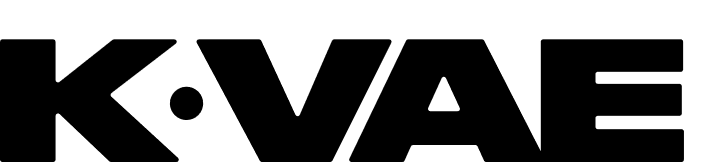
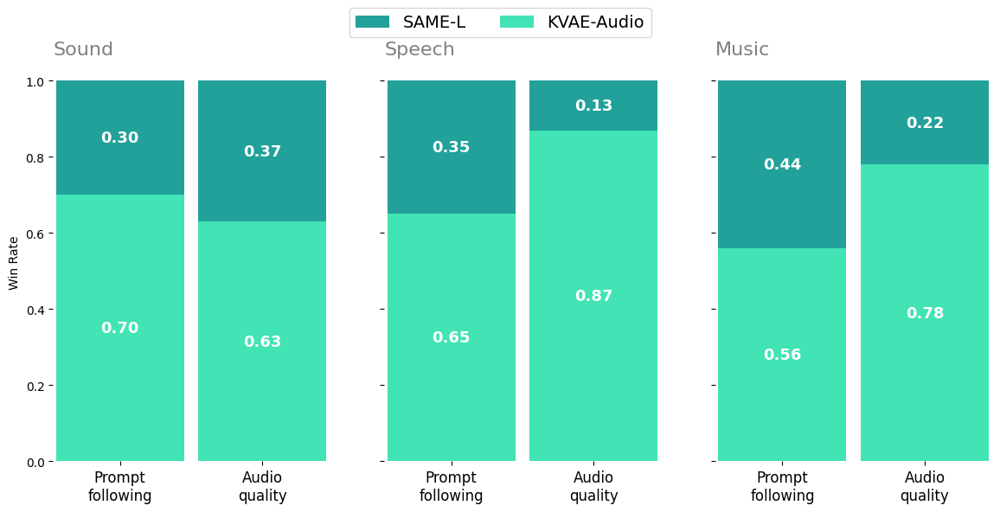
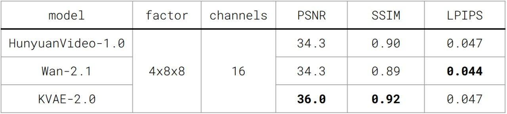
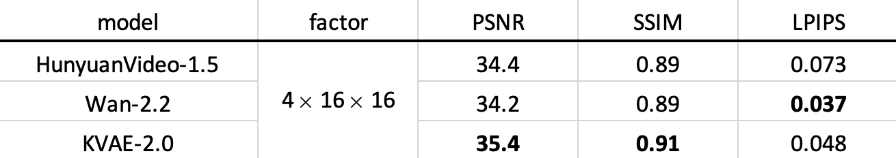
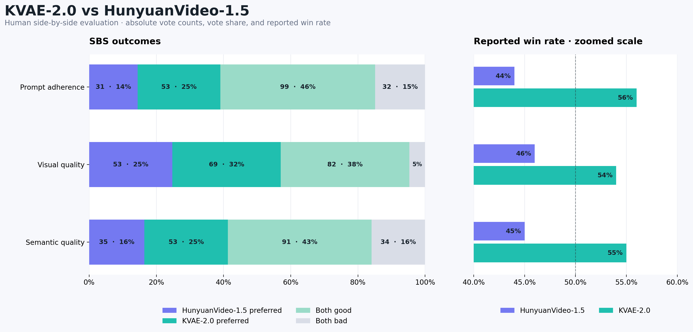
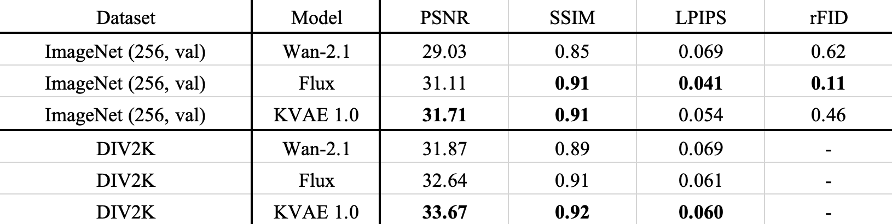
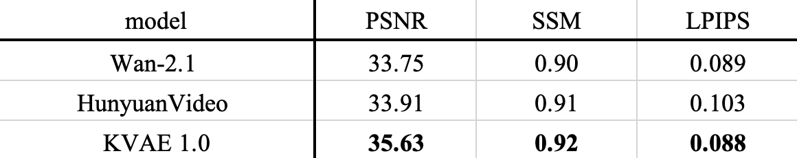

<div align="center">

  <picture>
    <source media="(prefers-color-scheme: dark)" srcset="assets/kvae-white-no-version.png">
    <source media="(prefers-color-scheme: light)" srcset="assets/kvae-black-no-version.png">
    
  </picture>

  <a href="https://kandinskylab.ai/open-source-kvae-3-en.html">Project page</a> | <a href="https://arxiv.org/abs/2608.05798">Previous technical report (KVAE 2.0)</a>

  Hugging Face collections: <a href="https://huggingface.co/collections/kandinskylab/kvae-30">KVAE 3.0</a> | <a href="https://huggingface.co/collections/kandinskylab/kvae-20-69e095d0531ff090c314914c">KVAE 2.0</a> | <a href="https://huggingface.co/collections/kandinskylab/kvae-10-691d98d9c643e5b99ca99ede">KVAE 1.0</a> | <a href="https://huggingface.co/collections/kandinskylab/kvae-audio-6a42481e7e0cbee9811b5a62">Audio</a>

</div>

# KVAE: audio, image, and video tokenizers

KVAE provides pretrained variational autoencoders for converting audio, images and videos into compact latent representations for diffusion generative models. All model classes use the same high-level workflow: `from_pretrained -> encode -> latent distribution -> decode`.

## Available models

The latest models are selected by default in the inference scripts and notebook.

| Release | Hugging Face model | Python class | Inference |
| --- | --- | --- | --- |
| Current | [KVAE-Audio-Stereo](https://huggingface.co/kandinskylab/KVAE-Audio-Stereo) | `KVAEAudio` | [`inference_1d_kvae.py`](scripts/inference_1d_kvae.py) |
| Current | [KVAE-2D-3.0](https://huggingface.co/kandinskylab/KVAE-2D-3.0) | `KVAEImage` | [`inference_2d_kvae.py`](scripts/inference_2d_kvae.py) |
| Current | [KVAE-3D-3.0](https://huggingface.co/kandinskylab/KVAE-3D-3.0) | `KVAEVideo` | [`inference_3d_kvae.py`](scripts/inference_3d_kvae.py) |
| Previous | [KVAE-Audio (mono)](https://huggingface.co/kandinskylab/KVAE-Audio) | `KVAEAudio` | [`inference_1d_kvae.py`](scripts/inference_1d_kvae.py) |
| Previous | [KVAE-2D-2.0](https://huggingface.co/kandinskylab/KVAE-2D-2.0) | `KVAEImage` | [`inference_2d_kvae.py`](scripts/inference_2d_kvae.py) |
| Previous | [KVAE-3D-2.0-t4s8](https://huggingface.co/kandinskylab/KVAE-3D-2.0-t4s8) | `KVAEVideo` | [`inference_3d_kvae.py`](scripts/inference_3d_kvae.py) |
| Previous | [KVAE-3D-2.0-t4s16](https://huggingface.co/kandinskylab/KVAE-3D-2.0-t4s16) | `KVAEVideo` | [`inference_3d_kvae.py`](scripts/inference_3d_kvae.py) |
| Previous | [KVAE-2D-1.0](https://huggingface.co/kandinskylab/KVAE-2D-1.0) | `KVAEImage` | [`inference_2d_kvae.py`](scripts/inference_2d_kvae.py) |
| Previous | [KVAE-3D-1.0](https://huggingface.co/kandinskylab/KVAE-3D-1.0) | `KVAEVideo` | [`inference_3d_kvae.py`](scripts/inference_3d_kvae.py) |

## Highlights

**KVAE-Audio-Stereo** encodes stereo audio at 48 kHz into 128-channel continuous latents at 50 Hz.

**KVAE-2D-3.0** compresses image height and width by a factor of 8 into 32 latent channels. It adds self-attention in the encoder and decoder bottlenecks and uses semantic feature alignment during training.

**KVAE-3D-3.0** compresses video spatially by 32 × 32 and temporally by 4 into 128 latent channels. Its causal, fully convolutional architecture supports temporal chunking and per-channel latent normalization.

<details>
<summary><b>Previous releases: selected evaluation figures</b></summary>

### KVAE-Audio latent-space qualities for generation



### KVAE-Video 2.0 reconstruction

#### t4s8



#### t4s16



### KVAE-Video 2.0 latent-space qualities for generation



</details>

<details>
<summary><b>Previous versions: KVAE 1.0</b></summary>

**KVAE-2D-1.0** uses 8 x 8 spatial compression with 16 latent channels and provides the original image tokenizer released with KVAE 1.0.



**KVAE-3D-1.0** uses 4 x 8 x 8 compression with 16 latent channels. It was evaluated at 540p, while the newer KVAE-Video 2.0 models target 720p evaluation and improved high-resolution processing.



</details>

Evaluation details for the latest models are available in their Hugging Face model cards. Earlier release results and audio generation examples are preserved in [assets/docs/EVALUATION.md](assets/docs/EVALUATION.md).

Earlier release announcements: [KVAE 1.0](https://habr.com/ru/companies/sberbank/articles/966450/), [KVAE 2.0](https://habr.com/ru/companies/sberbank/articles/1016814/), and [KVAE-Audio](https://habr.com/ru/companies/sberbank/articles/1053410/).

## Quick start

Create an environment with Python 3.11 and the PyTorch 2.8.0 CUDA 12.8 build,
then install this repository in editable mode:

```bash
conda create -n kvae_inference python=3.11
conda activate kvae_inference

pip install torch==2.8.0 torchvision==0.23.0 torchaudio==2.8.0 --index-url https://download.pytorch.org/whl/cu128
pip install -r requirements.txt
pip install --editable .
```

## Inference

Run commands from the repository root. The first run downloads weights from Hugging Face Hub unless they are already cached.

### Audio

```bash
python -m scripts.inference_1d_kvae \
    --dataset_folder ./assets/audio_test \
    --model KVAE-Audio-Stereo \
    --saving_folder ./outputs/audio
```

The default model supports stereo 48 kHz audio and runs in `float32`. Input is not resampled. For mono input, the script duplicates the channel for the stereo model and averages the reconstruction back to mono. The previous mono model remains available through `--model KVAE-Audio` and processes stereo channels independently. Saved reconstructions are loudness-matched to their input.

### Image

```bash
python -m scripts.inference_2d_kvae \
    --dataset_folder ./assets/images \
    --model KVAE_3.0 \
    --saving_folder ./outputs/images
```

Image inference uses `bfloat16` and expects PNG inputs normalized to the model range. Use `--img_size H,W` to resize samples to a common shape and enable batching; without an explicit size, the inference script uses batch size one. Reconstructions can be saved as PNG files, and the script reports PSNR and LPIPS.

### Video

```bash
python -m scripts.inference_3d_kvae \
    --dataset_folder ./assets/test1 \
    --model KVAE_3.0 \
    --seg_len 16 \
    --saving_folder ./outputs/video
```

Video inference uses `bfloat16`. Pass a dataset directory containing video files (such as MP4) or subdirectories of PNG frames. `--seg_len` controls temporal chunking, while `--input_norm` selects the input normalization convention. Per-channel latent normalization follows the checkpoint config by default; use the same setting for encoding and decoding.

Temporal context is cached inside the causal convolution, residual, and sampling blocks. These caches are mutable, so one `KVAEVideo` instance cannot safely process independent samples concurrently or interleave their chunks. Use a separate model instance per concurrent stream. Sequential calls are supported because `encode` and `decode` reset their caches before and after each call.

Detailed Python API examples, input layouts, metrics, and script options are in [assets/docs/INFERENCE.md](assets/docs/INFERENCE.md).

A runnable example for all three modalities is available in [scripts/inference_examples.ipynb](scripts/inference_examples.ipynb).

## Citation

For the previous KVAE 2.0 technical report:

```bibtex
@misc{kvae2026,
  title         = {KVAE: Family of Tokenizers for Multimodal Generative Models},
  author        = {Andrey Shutkin, Denis Parkhomenko, Ivan Kirillov,
                   Kirill Chernyshev, Kirill Malakhov, Ilia Vasiliev,
                   Ilia Trushkin, Valeriya Kobenko, David Chikovani,
                   Alexander Ivanov, Azat Saginbaev, Egor Silvestrov,
                   Ivan Mikheev, Konstantin Zakharov},
  year          = {2026},
  eprint        = {2608.05798},
  archivePrefix = {arXiv},
  primaryClass  = {cs.CV},
  url           = {https://arxiv.org/abs/2608.05798}
}
```

## License

The project is distributed under the terms of [LICENSE](LICENSE).
